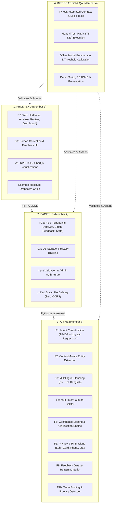
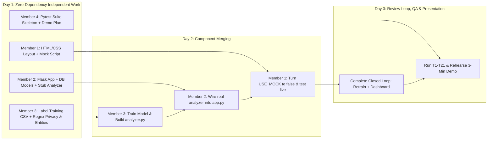

# DEVELOPMENT_PLAN.md
# Intelligent Customer Intent Detector
### Project Development Plan & Team Coordination Guide

> **Project Name:** Intelligent Customer Intent Detector (*"Decode The Unsaid"* / *SmartIntent AI*)  
> **Team:** The Alpha Coders (Team ID: CBC089)  
> **Domain:** Artificial Intelligence and Machine Learning (Problem ID: PS-030)  
> **Target Event:** Hackathon CBC 2.0, Design Round  
> **Core Reference:** [`PROJECT_SPECIFICATION.md`](file:///c:/HACKATHON/PROJECT_SPECIFICATION%20%281%29.md) and Submitted Presentation

---

## Executive Summary & Design Principles

This document establishes the architecture, component boundaries, development schedule, and collaboration protocol for our 4-person hackathon team. 

To ensure **zero blocking** during the hackathon:
1. **Clear Component Separation:** Frontend, Backend, and AI/ML operate across strictly defined boundaries.
2. **Mock-First Development:** The Frontend and Backend use mock implementations on Day 1, allowing UI and API logic to proceed before the ML model is trained.
3. **Single Source of Truth:** Data contracts (API JSON schemas, `intents.json`, and the `Analyzer.analyze()` Python signature) are frozen before implementation.
4. **Hackathon Pragmatism:** The tech stack avoids complex build tools (no Webpack, Vite, or React), heavyweight containers (no Docker), and paid third-party APIs. Everything runs locally on standard laptops using lightweight open-source Python and vanilla web standards.

---

## 1. Final Project Folder Structure

The project follows a clean, modular structure where Frontend, Backend, AI/ML, and Integration/Testing files are partitioned into dedicated directories:

```
c:/HACKATHON/
├── app.py                         # [Backend] Flask application entry point & HTTP router
├── requirements.txt               # [Backend/ML] Pinned Python dependencies
├── .env.example                   # [Backend] Template configuration environment variables
├── .gitignore                     # Git ignore rules (protects .env, models/, *.db, venv/)
├── README.md                      # [Integration] Quickstart setup and execution guide
├── PROJECT_SPECIFICATION (1).md   # Master specification document
├── DEVELOPMENT_PLAN.md            # This blueprint and execution plan
│
├── backend/                       # [Backend & AI Layer Interfaces]
│   ├── __init__.py                # Package initializer
│   ├── config.py                  # [Backend] Central configuration, thresholds & file paths
│   ├── database.py                # [Backend] SQLAlchemy ORM models, session & DB queries
│   ├── preprocess.py              # [AI/ML] Text normalization, language detection, clause splitter
│   ├── privacy.py                 # [AI/ML] PII detection, Luhn card check & data masking
│   ├── entity_extractor.py        # [AI/ML] Regex + gazetteer entity extraction engine
│   ├── intent_detector.py         # [AI/ML] TF-IDF + Logistic Regression classifier & keyword fallback
│   └── analyzer.py                # [AI/ML] Pipeline orchestrator: contracts, thresholds, routing, clarify
│
├── training/                      # [AI/ML Training & Evaluation Suite]
│   ├── train.py                   # Model training script, cross-validation & joblib export
│   └── evaluate.py                # Offline evaluation, confusion matrix, threshold analysis
│
├── data/                          # [AI/ML Data Assets & Knowledge Base]
│   ├── intents.json               # Intent definitions, team mappings & required entities
│   ├── training_data.csv          # Training dataset (English, Kannada script, Romanized Kanglish)
│   ├── test_messages.csv          # Held-out benchmark test set
│   └── products.txt               # Catalog gazetteer for product entity extraction
│
├── models/                        # [AI/ML Artifacts - Git Ignored]
│   ├── intent_model.joblib        # Trained scikit-learn pipeline artifact
│   └── model_info.json            # Metadata (training timestamp, CV score, sample counts)
│
├── frontend/                      # [Frontend Assets - Served statically by Flask]
│   ├── index.html                 # Single Page Application (Home, Analyze, Review, Dashboard)
│   ├── style.css                  # Custom responsive design system (CSS variables, flex/grid)
│   ├── script.js                  # Frontend logic, state management, API client & Chart.js logic
│   └── vendor/                    # Local vendored libraries (e.g. chart.umd.min.js for offline demo)
│
└── tests/                         # [Integration & QA Suite]
    ├── conftest.py                # Pytest fixtures and isolated SQLite configuration
    ├── test_api.py                # API endpoints, request validation and error schema tests
    ├── test_entities.py           # Entity extractor unit tests
    └── test_privacy.py            # PII masking and protected span preservation tests
```

---

## 2. Responsibilities of Each Team Member

| Role | Member Focus | Key Deliverables & Responsibilities | Files Owned |
|---|---|---|---|
| **Member 1** | **Frontend Development** (UI/UX & Client Logic) | • Build complete UI in `index.html` with clean responsive layout.<br>• Implement all 4 screens: Home (`#home`), Analyze (`#analyze`), Review Queue (`#review`), and Analytics Dashboard (`#dashboard`).<br>• Message input area with character counter and sample message chips.<br>• Rich results card (badges, model score indicator, entity chips, routing banner, clarification prompt, masked text view).<br>• Human Review UI (Confirm and Correct dropdown + submit).<br>• Chart.js visual dashboard (intent distribution, status breakdown, language mix).<br>• Robust client state: loading skeletons, input validation, banner alerts with retry.<br>• Offline styling and dark-mode friendly CSS tokens. | `frontend/index.html`<br>`frontend/style.css`<br>`frontend/script.js`<br>`frontend/vendor/*` |
| **Member 2** | **Backend Development** (API, DB & Orchestration) | • Flask REST server in `app.py` with static asset delivery.<br>• Robust input validation (type check, length, empty, symbol-only check).<br>• Standardized JSON error response handler (consistent code/message).<br>• Database schema and queries using SQLAlchemy in `backend/database.py`.<br>• Endpoints: `/api/health`, `/api/intents`, `/api/analyze`, `/api/analyze/batch`, `/api/feedback`, `/api/history`, `/api/stats`, `DELETE /api/history`.<br>• Hybrid DB support: MySQL 8 with zero-config SQLite fallback.<br>• Retention purge command and data security enforcement. | `app.py`<br>`backend/database.py`<br>`backend/config.py`<br>`.env.example` |
| **Member 3** | **AI/ML Development** (NLP, Training & Inference) | • Curate `data/training_data.csv`, `test_messages.csv`, and `products.txt`.<br>• Build NLP pipeline: `preprocess.py` (normalization, language detection heuristics, clause splitter).<br>• Build `privacy.py` (PII masking: cards + Luhn check, phone, email, UPI, Aadhaar, PAN).<br>• Build `entity_extractor.py` (context-aware order IDs, amounts, dates, products, issue terms).<br>• Build `intent_detector.py` (TF-IDF word + character n-grams + Logistic Regression with keyword fallback mode).<br>• Build `analyzer.py` implementing `Analyzer.analyze(text)` returning the exact contracted dictionary.<br>• Ambiguity scoring, margin thresholds, clause-based multi-intent ranking, and targeted clarification questions.<br>• Training (`train.py`) and evaluation (`evaluate.py`) scripts with feedback-loop support. | `backend/preprocess.py`<br>`backend/privacy.py`<br>`backend/entity_extractor.py`<br>`backend/intent_detector.py`<br>`backend/analyzer.py`<br>`training/*`<br>`data/*` |
| **Member 4** | **Integration, QA, Docs & Coordination** | • Manage Git branch integration, cross-component merge requests and CI-style testing.<br>• Build automated test suite with `pytest` in `tests/` covering API, privacy, and entities.<br>• Verify end-to-end user workflows (Test cases T1–T21 from spec).<br>• Verify 14 demo sample messages across English, Kannada, Kanglish, and PII cases.<br>• Author comprehensive `README.md` and offline execution guides.<br>• Prepare final 3-minute demo script, slide deck, and presentation rehearsal. | `tests/*`<br>`README.md`<br>Project documentation & demo assets |

---

## 3. Technologies Selected and Rationale

| Layer | Selected Technology | Why Selected (Benefits for Hackathon) | Why Alternatives Rejected |
|---|---|---|---|
| **Frontend Framework** | **HTML5 + Modern CSS3 + Vanilla JavaScript (ES6+)** | Zero build steps (no npm build, no node modules bundle step). Instant reload in browser. Lightweight and easy to debug for team members. | **React/Vue/Angular/Vite:** Adds dependency friction, node version mismatches, and build errors under tight time limits. |
| **Styling & Design System** | **Custom Vanilla CSS with CSS Custom Properties** | Total control over responsive layout, typography, glassmorphism, micro-animations, and theme tokens without configuration overhead. | **TailwindCSS:** Requires PostCSS build setup or heavy runtime CDN script. Vanilla CSS is cleaner for 4-view SPA. |
| **Data Visualization** | **Chart.js 4 (vendored UMD script)** | Small footprint, zero-build, responsive Canvas rendering. Works completely offline when vendored. | **D3.js / Recharts:** Overkill for simple distribution charts; Recharts requires React. |
| **Backend Framework** | **Python 3.10+ with Flask 3.x** | Directly promised in submitted PPT. Native static file serving ensures zero CORS configuration. Extremely clean REST routing. | **FastAPI:** Highly capable, but Flask matches the PPT specification, has simpler static-file serving, and avoids Pydantic v1/v2 migration confusion. |
| **Data Persistence** | **SQLAlchemy 2.x + PyMySQL (MySQL 8 with SQLite fallback)** | PPT committed to MySQL. SQLAlchemy provides an ORM layer that lets teammates run seamlessly on local SQLite (`sqlite:///intent.db`) without requiring MySQL installed, while maintaining full MySQL 8 compatibility for production. | **Raw SQL:** Prone to syntax differences between DB engines and SQL injection. |
| **Machine Learning** | **scikit-learn (TF-IDF + Logistic Regression)** | Trains in seconds on a standard laptop CPU; returns calibrated probabilities via `predict_proba`; char n-grams natively handle Kannada script, typos, and Romanized Kanglish. | **Transformers (BERT/LLMs):** Requires high-end GPU, gigabytes of download, slow inference, and paid API risks. |
| **Information Extraction (NER)** | **Python `re` + Longest-Match Product Gazetteer** | Context-aware regex rules (order ID only near keywords, currency formats) and gazetteer lookup are deterministic, explainable, and lightning-fast. | **spaCy NER:** Requires downloading language models which often fail on Indic romanized strings without substantial training data. |
| **Testing** | **pytest** | Fast, standard Python testing framework for contract validation and regression prevention. | **unittest:** Verbose boilerplate compared to pytest's clean assertions. |

---

## 4. Features Assigned to Each Component

The following matrix maps all promised PPT features (F1–F14) and value-add features (A1–A8) to individual components:



### Detailed Component Mapping

#### 1. Frontend Component (Member 1)
- **F7 Web Interface:** 
  - Input card with multi-line textarea, character counter (max 1000), "Analyze" button, and pre-loaded test message dropdown chips.
  - Dynamic result view: Status badges (`confident`, `needs_clarification`, `multi_intent`, `unknown`, `unsupported`), language chip, urgency tag, model score progress bar, entity pills, routing target, clarification banner, and masked text box.
- **F8 Human Review Interface:** Dedicated `#review` view for predictions flagged with `needs_review = true`. Offers "Confirm" and "Correct" (with intent selection dropdown) actions.
- **A1 Analytics Dashboard:** `#dashboard` view displaying 4 KPI summary cards and 3 Chart.js charts (Intent Distribution, Status Split, Language Mix) plus a recent history table.
- **Client Resilience:** Graceful loading spinners, client-side empty-field validation, and dismissible error banners with retry triggers.

#### 2. Backend Component (Member 2)
- **F12 REST API:** Unified HTTP interface handling single requests (`/api/analyze`) and batch processing (`/api/analyze/batch`, up to 50 items).
- **Request Validation & Security:** Strict payload validation (valid JSON, string type, non-empty, max length, letter content check, max payload 256KB).
- **F14 Data Persistence:** SQLAlchemy models saving masked customer text, top intent, confidence, status, routing, and review state. Seamless switching between MySQL and SQLite.
- **F8 Feedback Endpoints:** `/api/feedback` to register human reviewer decisions, updating database records for retraining.
- **Reporting & Admin:** `/api/stats` endpoint aggregating database counts, `/api/history` with pagination/filtering, and secured `DELETE /api/history` admin purge.

#### 3. AI/ML Component (Member 3)
- **F1 Intent Classifier:** scikit-learn Pipeline (FeatureUnion of word n-grams (1,2) and char_wb n-grams (2,5) + Logistic Regression) providing probability estimates.
- **F2 Entity Extractor:** Context-aware extraction of `order_id` (prefixed like `ORD-12345` or labelled like `order 48213`), `amount` (currencies ₹, Rs, INR, $), `date` (relative and calendar formats), `product` (gazetteer), and `issue` keywords.
- **F3 Multilingual Processing:** Heuristic language detection (`en`, `kn`, `kn-latn`, `mixed`) with dual-script char n-gram classification.
- **F4 Multi-Intent Detection:** Clause segmentation on punctuation and multilingual conjunctions (`and`, `but`, `mattu`, `aadre`), analyzing individual clauses for secondary intents.
- **F5 Confidence, Ambiguity & Clarification:** Dual-threshold margin decision logic. Dispatches targeted clarification questions for ambiguous pairs (e.g. `payment_issue` vs `refund_request`) or missing mandatory entities (e.g. missing `order_id`).
- **F6 Privacy & PII Masking:** Regex-based detector for card numbers (with Luhn validation), phone numbers, email addresses, UPI IDs, PAN, Aadhaar, and OTPs. Protected span logic ensures order IDs are never masked.
- **F10 Routing & F13 Urgency:** Maps classified intents to destination support teams; detects urgency cues (`urgent`, `deducted`, `charged twice`, `ಬೇಗ`).
- **F9 Feedback Retraining:** Training script supporting `--include-feedback` to ingest human corrections stored in the database.

#### 4. Integration, Testing & Docs (Member 4)
- **Test Automation:** Comprehensive pytest suite verifying API status codes, error schemas, entity extraction precision, and privacy masking.
- **Test Matrix (T1–T21):** Verification of all edge cases (empty strings, symbol-only messages, database outages, long inputs, fallback mode).
- **Benchmark Evaluation:** Run `training/evaluate.py` to produce confusion matrix, macro-F1, and threshold calibration tables.
- **Documentation & Presentation:** Detailed setup instructions, sample execution commands, and pitch presentation slides.

---

## 5. API Endpoints and JSON Request/Response Specifications

### 5.1 Endpoint Catalog

| Method | Endpoint | Description | Request Body | Response Status |
|---|---|---|---|---|
| `GET` | `/api/health` | System health & detector mode | None | 200 OK |
| `GET` | `/api/intents` | Supported intents list for dropdowns | None | 200 OK |
| `POST` | `/api/analyze` | Primary intent analysis for a single message | JSON Object | 200 OK / 400 / 422 |
| `POST` | `/api/analyze/batch` | Batch processing (up to 50 messages) | JSON Object | 200 OK / 400 |
| `POST` | `/api/feedback` | Record human review action (confirm/correct) | JSON Object | 200 OK / 400 / 404 |
| `GET` | `/api/history` | List stored predictions & review queue | Query Params | 200 OK / 400 |
| `GET` | `/api/stats` | Aggregate dashboard statistics | None | 200 OK |
| `DELETE`| `/api/history` | Admin purge of stored history | Header: `X-Admin-Token` | 200 OK / 403 Forbidden |

---

### 5.2 Error Response Format

All 4xx and 5xx errors return a uniform JSON schema:

```json
{
  "error": {
    "code": "empty_message",
    "message": "Please enter a message."
  }
}
```

*Standard Error Codes:* `invalid_json`, `invalid_message`, `empty_message`, `message_too_long`, `no_text_content`, `invalid_messages`, `too_many_messages`, `invalid_id`, `invalid_action`, `invalid_intent`, `not_found`, `forbidden`, `internal_error`.

---

### 5.3 Detailed Endpoint Schemas

#### 1. `GET /api/health`
**Response (200 OK):**
```json
{
  "status": "ok",
  "detector_mode": "trained"
}
```
*(Note: `detector_mode` is `"trained"` when `models/intent_model.joblib` is loaded, or `"keyword_fallback"` if running without a trained model).*

---

#### 2. `GET /api/intents`
**Response (200 OK):**
```json
{
  "intents": [
    { "label": "order_tracking", "display": "Order Tracking" },
    { "label": "order_cancellation", "display": "Order Cancellation" },
    { "label": "refund_request", "display": "Refund Request" },
    { "label": "product_information", "display": "Product Information" },
    { "label": "complaint", "display": "Complaint" },
    { "label": "return_exchange", "display": "Return / Exchange" },
    { "label": "payment_issue", "display": "Payment Issue" },
    { "label": "delivery_problem", "display": "Delivery Problem" },
    { "label": "general_inquiry", "display": "General Inquiry" },
    { "label": "out_of_scope", "display": "Unsupported" }
  ]
}
```

---

#### 3. `POST /api/analyze`
**Request Payload:**
```json
{
  "message": "My payment failed but Rs. 2,499 was deducted. Please refund it urgently.",
  "save": true
}
```

**Response (200 OK - Multi-Intent & Urgent Example):**
```json
{
  "id": 42,
  "message_masked": "My payment failed but Rs. 2,499 was deducted. Please refund it urgently.",
  "language": "en",
  "status": "multi_intent",
  "multi_intent": true,
  "intents": [
    {
      "label": "payment_issue",
      "display": "Payment Issue",
      "confidence": 0.62,
      "clause": "My payment failed"
    },
    {
      "label": "refund_request",
      "display": "Refund Request",
      "confidence": 0.58,
      "clause": "Please refund it urgently"
    }
  ],
  "alternatives": [],
  "entities": [
    { "type": "amount", "value": "INR 2499" },
    { "type": "issue", "value": "deducted" }
  ],
  "missing_entities": ["order_id"],
  "urgency": "high",
  "clarification_question": "Could you share your Order ID so we can look into this?",
  "needs_review": false,
  "route_to": {
    "teams": ["Payments & Billing", "Refunds & Billing"],
    "priority": "high"
  },
  "pii_masked": {},
  "model": {
    "mode": "trained",
    "note": "Scores are model outputs, not calibrated probabilities."
  }
}
```

**Response (200 OK - Ambiguous / Needs Clarification Example):**
```json
{
  "id": 43,
  "message_masked": "I was charged but I cannot see my order.",
  "language": "en",
  "status": "needs_clarification",
  "multi_intent": false,
  "intents": [
    {
      "label": "payment_issue",
      "display": "Payment Issue",
      "confidence": 0.44,
      "clause": null
    }
  ],
  "alternatives": [
    {
      "label": "order_tracking",
      "display": "Order Tracking",
      "confidence": 0.39
    }
  ],
  "entities": [],
  "missing_entities": [],
  "urgency": "normal",
  "clarification_question": "Is your payment not going through, or is the payment done and you cannot see your order?",
  "needs_review": true,
  "route_to": {
    "teams": ["Human Review Queue"],
    "priority": "normal"
  },
  "pii_masked": {},
  "model": {
    "mode": "trained",
    "note": "Scores are model outputs, not calibrated probabilities."
  }
}
```

**Response (200 OK - PII Masked Example):**
*(Input: `"My card 4111 1111 1111 1111 was charged, call 9876543210 or email user@test.com"`)*
```json
{
  "id": 44,
  "message_masked": "My card [CARD] was charged, call [PHONE] or email [EMAIL]",
  "language": "en",
  "status": "confident",
  "multi_intent": false,
  "intents": [
    {
      "label": "payment_issue",
      "display": "Payment Issue",
      "confidence": 0.72,
      "clause": null
    }
  ],
  "alternatives": [
    { "label": "refund_request", "display": "Refund Request", "confidence": 0.15 }
  ],
  "entities": [],
  "missing_entities": [],
  "urgency": "normal",
  "clarification_question": null,
  "needs_review": false,
  "route_to": {
    "teams": ["Payments & Billing"],
    "priority": "normal"
  },
  "pii_masked": {
    "CARD": 1,
    "PHONE": 1,
    "EMAIL": 1
  },
  "model": {
    "mode": "trained",
    "note": "Scores are model outputs, not calibrated probabilities."
  }
}
```

---

#### 4. `POST /api/analyze/batch`
**Request Payload:**
```json
{
  "messages": [
    "Where is my order #48213?",
    "",
    "Cancel ORD-77120"
  ],
  "save": true
}
```

**Response (200 OK):**
```json
{
  "results": [
    {
      "index": 0,
      "result": {
        "id": 45,
        "message_masked": "Where is my order #48213?",
        "status": "confident",
        "intents": [{ "label": "order_tracking", "display": "Order Tracking", "confidence": 0.78 }]
      }
    },
    {
      "index": 1,
      "error": {
        "code": "empty_message",
        "message": "Please enter a message."
      }
    },
    {
      "index": 2,
      "result": {
        "id": 46,
        "message_masked": "Cancel ORD-77120",
        "status": "confident",
        "intents": [{ "label": "order_cancellation", "display": "Order Cancellation", "confidence": 0.82 }]
      }
    }
  ]
}
```

---

#### 5. `POST /api/feedback`
**Request Payload (Confirm Action):**
```json
{
  "prediction_id": 43,
  "action": "confirm"
}
```

**Request Payload (Correct Action):**
```json
{
  "prediction_id": 43,
  "action": "correct",
  "corrected_intent": "order_tracking"
}
```

**Response (200 OK):**
```json
{
  "id": 43,
  "review_status": "corrected",
  "corrected_intent": "order_tracking",
  "top_intent": "payment_issue",
  "confidence": 0.44,
  "status": "needs_clarification",
  "language": "en",
  "message_masked": "I was charged but I cannot see my order.",
  "urgency": "normal",
  "needs_review": true
}
```

---

#### 6. `GET /api/history`
**Query Parameters:** `limit` (default: 50, max: 200), `status` (optional), `review` (e.g. `pending`, `confirmed`, `corrected`).
**Example Request:** `/api/history?limit=10&review=pending`
**Response (200 OK):**
```json
{
  "items": [
    {
      "id": 43,
      "created_at": "2026-10-10T16:20:00Z",
      "message_masked": "I was charged but I cannot see my order.",
      "language": "en",
      "top_intent": "payment_issue",
      "confidence": 0.44,
      "status": "needs_clarification",
      "multi_intent": false,
      "urgency": "normal",
      "needs_review": true,
      "review_status": "pending",
      "corrected_intent": null,
      "clarification_question": "Is your payment not going through, or is the payment done and you cannot see your order?",
      "intents": [{ "label": "payment_issue", "confidence": 0.44 }],
      "entities": [],
      "route_to": { "teams": ["Human Review Queue"], "priority": "normal" }
    }
  ]
}
```

---

#### 7. `GET /api/stats`
**Response (200 OK):**
```json
{
  "total": 120,
  "by_intent": {
    "order_tracking": 35,
    "refund_request": 28,
    "payment_issue": 24,
    "order_cancellation": 15,
    "product_information": 10,
    "complaint": 8
  },
  "by_status": {
    "confident": 75,
    "multi_intent": 20,
    "needs_clarification": 15,
    "unknown": 8,
    "unsupported": 2
  },
  "by_language": {
    "en": 82,
    "kn": 20,
    "kn-latn": 14,
    "mixed": 4
  },
  "pending_review": 12,
  "high_urgency": 18,
  "avg_score": 0.638,
  "reviewer_agreement": 0.875
}
```

---

## 6. Clear Component Interfaces & Contracts

To allow Frontend, Backend, and AI/ML engineers to work independently without merge conflicts or blockers, the interfaces between each layer are strictly specified below.

```
+------------------------------------------------------------------------+
|                          1. FRONTEND LAYER                             |
|  (index.html, style.css, script.js)                                    |
+------------------------------------------------------------------------+
                                  │
                                  │  [Contract 1: HTTP REST JSON API]
                                  │  POST /api/analyze, /api/feedback, etc.
                                  ▼
+------------------------------------------------------------------------+
|                          2. BACKEND LAYER                              |
|  (app.py, backend/config.py, backend/database.py)                      |
+------------------------------------------------------------------------+
                                  │
                                  │  [Contract 2: Python Class Interface]
                                  │  Analyzer.analyze(raw_text: str) -> dict
                                  ▼
+------------------------------------------------------------------------+
|                          3. AI / ML LAYER                              |
|  (analyzer.py, intent_detector.py, entity_extractor.py, privacy.py)    |
+------------------------------------------------------------------------+
```

### 6.1 Frontend <-> Backend Contract
1. **Endpoint Paths & Methods:** Follow Section 5.
2. **Mock Mode in Frontend:**  
   `frontend/script.js` contains a top-level flag:
   ```javascript
   const USE_MOCK = false; // set to true when developing UI independently
   ```
   When `USE_MOCK = true`, the UI returns static test fixtures matching the exact JSON shapes defined in Section 5.3. This enables Member 1 to build and test the entire UI immediately.
3. **Safe DOM Rendering:** The frontend will **never** assign untrusted API responses to `innerHTML`. All text content must be injected via `textContent` or `document.createElement()`.
4. **Unified Origin:** The Flask app serves `frontend/index.html` at the root path (`/`) and static files from `frontend/`. No CORS configuration is required.

---

### 6.2 Backend <-> AI/ML Contract (`Analyzer.analyze`)
The Backend (`app.py`) interacts with the AI/ML subsystem exclusively through one Python class and its method:

```python
from backend.analyzer import Analyzer

# Instantiated once at application startup:
analyzer = Analyzer()

# Public method called per request:
result: dict = analyzer.analyze(raw_text: str)
```

#### The `Analyzer.analyze()` Guarantee
`analyze()` must always return a dictionary with the following exact keys and types:

```python
{
    "message_masked": str,             # Normalized string with PII replaced by [CARD], [PHONE], etc.
    "language": str,                   # One of: 'en', 'kn', 'kn-latn', 'mixed', 'unknown'
    "status": str,                     # One of: 'confident', 'multi_intent', 'needs_clarification', 'unknown', 'unsupported'
    "multi_intent": bool,              # True if 2 or more distinct intent clauses detected
    "intents": list[dict],             # [{"label": str, "display": str, "confidence": float, "clause": str | None}]
    "alternatives": list[dict],        # [{"label": str, "display": str, "confidence": float}] (runner-ups for single-intent)
    "entities": list[dict],            # [{"type": str, "value": str}]
    "missing_entities": list[str],     # List of missing mandatory entity types (e.g. ['order_id'])
    "urgency": str,                    # 'high' or 'normal'
    "clarification_question": str | None, # Generated question if ambiguous/missing entities, else None
    "needs_review": bool,              # Flag indicating if this prediction should enter the review queue
    "route_to": dict,                  # {"teams": list[str], "priority": str}
    "pii_masked": dict[str, int],      # e.g. {"CARD": 1, "PHONE": 1}
    "model": dict                      # {"mode": "trained" | "keyword_fallback", "note": str}
}
```

#### Backend Stub for Day 1
Before Member 3 completes the AI model, Member 2 can use a lightweight stub in `backend/analyzer.py` returning static responses matching this dictionary structure.

---

### 6.3 Backend <-> Database Interface
The database layer (`backend/database.py`) encapsulates all SQLAlchemy interactions:

```python
# Initialize tables:
init_db() -> None

# Save prediction (returns primary key ID):
save_prediction(result: dict) -> int

# Query predictions:
list_predictions(limit: int = 50, status: str = None, review: str = None) -> list[dict]

# Record reviewer feedback:
apply_feedback(pid: int, action: str, corrected_intent: str = None) -> dict | None

# Aggregate statistics for charts:
stats() -> dict

# Export reviewed examples for retraining:
get_feedback_rows() -> list[tuple[str, str]]

# Purge old records:
purge_older_than(days: int) -> int
purge_all() -> int
```

---

## 7. Sample Customer Messages and Expected Outputs

The following 14 benchmark messages must be pre-populated in the UI's sample message dropdown and verified during testing:

| ID | Test Category | Input Message Text | Expected Primary Intent | Key Entities Extracted | Urgency | Expected Status | Clarification Question |
|---|---|---|---|---|---|---|---|
| **M1** | Clear Tracking | `"Where is my order #48213? It was supposed to arrive yesterday."` | `order_tracking` | `order_id`: 48213<br>`date`: yesterday | normal | `confident` | None |
| **M2** | Clear Cancellation | `"I want to cancel order ORD-77120, I ordered it by mistake."` | `order_cancellation` | `order_id`: ORD-77120 | normal | `confident` | None |
| **M3** | Multi-Intent (PPT) | `"My payment failed but Rs. 2,499 was deducted. Please refund it urgently."` | `payment_issue` + `refund_request` | `amount`: INR 2499<br>`issue`: deducted | **high** | `multi_intent` | *"Could you share your Order ID so we can look into this?"* |
| **M4** | Multi-Intent Defect | `"The wireless earbuds I got yesterday have a broken left speaker and I want to exchange them."` | `return_exchange` | `product`: wireless earbuds<br>`date`: yesterday<br>`issue`: broken | normal | `multi_intent` | *"Could you share your Order ID so we can look into this?"* |
| **M5** | Product Inquiry | `"Does the Galaxy M14 come in blue and does it support fast charging?"` | `product_information` | `product`: Galaxy M14 | normal | `confident` | None |
| **M6** | Ambiguous Request | `"I was charged but I can't see my order."` | `payment_issue` vs `order_tracking` | None | normal | `needs_clarification` | *"Is your payment not going through, or is the payment done and you cannot see your order?"* |
| **M7** | Complaint / Delivery | `"This is the third time my delivery is late and nobody is answering. Terrible service!"` | `delivery_problem` + `complaint` | `issue`: late | normal | `confident` or `multi_intent` | None |
| **M8** | Extremely Vague | `"It's not working."` | Low confidence across classes | None | normal | `unknown` | *"Could you tell us a bit more? For example, is this about an order, a payment, a delivery, or a product?"* |
| **M9** | Out of Scope | `"What's the weather like in Bengaluru today?"` | `out_of_scope` | None | normal | `unsupported` | None (*"This request is outside customer support scope"*)|
| **M10**| Kannada Script | `"ನನ್ನ ಆರ್ಡರ್ ಎಲ್ಲಿದೆ? ಇನ್ನೂ ಬಂದಿಲ್ಲ"` | `order_tracking` | None | normal | `confident` | *"Could you share your Order ID so we can look into this?"* |
| **M11**| Romanized Kannada | `"Nanna order cancel madi, hana refund beku"` | `order_cancellation` + `refund_request` | None | normal | `multi_intent` | *"Could you share your Order ID so we can look into this?"* |
| **M12**| General Inquiry | `"Hi, what are your customer care working hours?"` | `general_inquiry` | None | normal | `confident` | None |
| **M13**| High-Risk PII | `"My card 4111 1111 1111 1111 was charged twice, call me on 9876543210 or mail asha@example.com"` | `payment_issue` | `issue`: charged twice | **high** | `confident` | None (PII masked: `[CARD]`, `[PHONE]`, `[EMAIL]`) |
| **M14**| Return / Exchange | `"Order 51234 arrived with the wrong size, how do I exchange it?"` | `return_exchange` | `order_id`: 51234<br>`issue`: wrong size | normal | `confident` | None |

---

## 8. Integration, Testing, and Verification Plan

### 8.1 Step-by-Step Integration Milestones

```mermaid
gantt
    title Hackathon Development & Integration Timeline
    dateFormat  HH:mm
    axisFormat  %H:%M
    section Milestones
    CP0 - Repo Setup & Contracts Frozen   :milestone, cp0, 00:00, 0m
    CP1 - UI Mocks & Stub API Operational :milestone, cp1, after cp0, 120m
    CP2 - AI Pipeline Integrated with API :milestone, cp2, after cp1, 150m
    CP3 - Human Review & Dashboard Loop   :milestone, cp3, after cp2, 120m
    CP4 - Feature Freeze, QA & Rehearsal  :milestone, cp4, after cp3, 90m
```



| Checkpoint | Gate Condition | Validation Test | Responsible |
|---|---|---|---|
| **CP0: Kickoff** | Repo structure initialized, dependencies installed in `venv`, contracts agreed. | `python -c "import flask, sklearn, sqlalchemy; print('OK')"` runs without errors. | All Members |
| **CP1: Skeleton** | Member 2 runs `app.py` with stub endpoints; Member 1 tests UI with `USE_MOCK = true`. | UI submits sample message to local Flask server and renders stub card correctly. | Members 1 & 2 |
| **CP2: Core AI** | Member 3 connects `analyzer.py` (with trained model or keyword fallback) to Backend. | Running sample messages M1–M14 returns expected intents and extracted entities. Pytest passes. | Members 2, 3 & 4 |
| **CP3: Closed Loop**| Review queue updates predictions; stats reflect in Chart.js; feedback retraining works. | Confirming/correcting an ambiguous message updates `/api/stats` and DB status. | All Members |
| **CP4: Final Polish**| Feature freeze. UI offline check (vendored Chart.js), mobile responsiveness verified. | Run 3-minute demo script twice end-to-end without errors. | Member 4 Lead |

---

### 8.2 Test Suite Matrix (T1 to T21)

Member 4 will ensure every test case below passes before project submission:

| ID | Test Focus | Input / Condition | Expected Behavior |
|---|---|---|---|
| **T1** | Core Tracking Intent | Message M1 | Intent classified as `order_tracking`, status not `unknown`. |
| **T2** | Product Inquiry Intent | Message M5 | Intent classified as `product_information`. |
| **T3** | Order ID Extraction | `"Where is my order #48213?"` | Entities list contains `{"type": "order_id", "value": "48213"}`. |
| **T4** | Amount Extraction | `"Rs. 2,499 was deducted"` | Entities list contains `{"type": "amount", "value": "INR 2499"}`. |
| **T5** | False-Positive Phone Avoidance| `"order 9876543210"` | Extracted as `order_id`, **not** masked as a phone number. |
| **T6** | Ambiguity & Clarification | Message M6 | Status is `needs_clarification`, returns targeted clarification question. |
| **T7** | Multi-Intent Detection | Message M3 or M11 | Status is `multi_intent`, contains 2 ranked intent objects. |
| **T8** | Unknown / Low Confidence | Message M8 (`"It's not working."`) | Status is `unknown`, `needs_review = true`, lands in review queue. |
| **T9** | Out of Scope Decline | Message M9 (weather question) | Status is `unsupported`, no support team assigned. |
| **T10**| Privacy PII Masking | Message M13 | Masked text contains `[CARD]`, `[PHONE]`, `[EMAIL]`. Raw data not in DB. |
| **T11**| Empty Input Handling | `"   "` or empty string | Backend returns 400 `empty_message`. UI shows inline error. |
| **T12**| Non-Text / Symbol Input | `"12345 !!!"` | Backend returns 422 `no_text_content`. UI prevents request. |
| **T13**| Message Length Cap | 1001 characters | Backend returns 400 `message_too_long`. UI character counter flags red. |
| **T14**| Database Resilience | Stop DB or simulate DB error | `/api/analyze` still returns 200 with `id: null`. App does not crash. |
| **T15**| Network Error Handling | Backend stopped | UI shows dismissible red banner with retry button. No blank screen. |
| **T16**| Feedback Validation | Invalid intent or missing ID | Returns 400 `invalid_intent` or 404 `not_found`. |
| **T17**| Retraining Feedback Ingestion| Run `train.py --include-feedback` | Terminal reports ingestion of reviewed database rows. |
| **T18**| XSS Vulnerability Check | `<script>alert(1)</script>` | Injected tags rendered as plain text. No script execution. |
| **T19**| Fallback Resilience | Delete model file, restart server| App starts in `keyword_fallback` mode. `/api/health` indicates fallback. |
| **T20**| Batch Processing Bounds | 51 messages submitted | Returns 400 `too_many_messages`. |
| **T21**| Responsive Viewport Check | DevTools at 360px & 768px | No horizontal page scrolling; tap targets ≥ 44px; tables scroll internally. |

---

## 9. Development Order, Dependencies & Day-1 Execution Guide

### 9.1 Component Dependency Graph



---

### 9.2 Immediate Day-1 Action Items for Each Member

#### How Member 1 (Frontend) Starts Immediately:
1. Create `frontend/index.html` with basic skeleton containing the 4 views (`#home`, `#analyze`, `#review`, `#dashboard`).
2. Create `frontend/style.css` using modern CSS variables (`--bg`, `--surface`, `--accent`, `--ok`, `--warn`, `--bad`).
3. Create `frontend/script.js` with `const USE_MOCK = true` and sample mock fixtures for M1, M3, and M6.
4. Build the Analyze interface: textarea, character counter, Analyze button, and pre-populated sample message chips.
5. Render the result card (model score bar, entity badges, routing cards, clarification banner).

#### How Member 2 (Backend) Starts Immediately:
1. Create virtual environment and install `requirements.txt`.
2. Create `backend/config.py` reading environment variables via `python-dotenv`.
3. Create `backend/database.py` with SQLAlchemy `Prediction` model and default SQLite database URL (`sqlite:///intent.db`).
4. Create `app.py` with endpoints (`/api/health`, `/api/intents`, `/api/analyze`, `/api/feedback`, `/api/history`, `/api/stats`).
5. In `app.py`, implement input validation and connect a temporary stub `analyzer.py` returning static dictionaries matching Section 6.2.

#### How Member 3 (AI/ML) Starts Immediately:
1. Verify `data/intents.json` matches the 10 supported categories.
2. Build `data/products.txt` with sample catalog items.
3. Create `backend/privacy.py` (implementing PII regexes and Luhn credit card validation).
4. Create `backend/entity_extractor.py` (regex rules for order IDs, amounts, dates, and gazetteer lookup).
5. Build and populate `data/training_data.csv` (aiming for 30–40 examples per intent in English, 10–15 in Kannada and Romanized Kanglish).
6. Build `training/train.py` using TF-IDF (word + char n-grams) and Logistic Regression, running the first training pass to export `models/intent_model.joblib`.

#### How Member 4 (Integration & QA) Starts Immediately:
1. Set up the Git repository with branches: `feature/frontend`, `feature/backend`, `feature/aiml`.
2. Create `tests/conftest.py` setting `DATABASE_URL = "sqlite:///test_intent.db"`.
3. Author `tests/test_api.py`, `tests/test_privacy.py`, and `tests/test_entities.py` testing against the contracted specifications.
4. Document the setup commands in `README.md`.
5. Prepare the demo slide deck outline and timing structure based on Section 15 of the project specification.

---

## 10. Summary of Deliverables per Member for Review

Before merging to `main`, each member must present their component deliverables:

- **Member 1 (Frontend):** Responsive SPA with all 4 views functioning against mock data; Chart.js rendering sample distribution charts; zero visual defects on mobile viewports.
- **Member 2 (Backend):** Functional Flask server with static routing, strict request validation, all 8 REST endpoints working with SQLite, and comprehensive error handling.
- **Member 3 (AI/ML):** Curated training and test CSVs; `models/intent_model.joblib` artifact; fully tested `Analyzer` pipeline delivering the exact JSON specification.
- **Member 4 (Integration):** 100% passing pytest suite; validation of test cases T1–T21; complete `README.md`; 3-minute pitch demo script.

---
*End of DEVELOPMENT_PLAN.md. This document serves as the contract and operational guide for CBC 2.0.*
